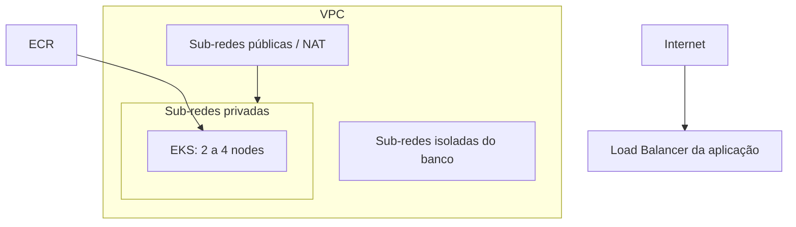

# Oficina Mecânica — Infraestrutura Kubernetes

Provisiona exclusivamente a infraestrutura de execução da aplicação: VPC, sub-redes, EKS escalável, add-ons e ECR. Deployment, Service, HPA, ConfigMap e Ingress pertencem ao repositório da aplicação principal.

## Arquitetura



Pré-requisitos: Terraform 1.11+, AWS CLI e credenciais por OIDC no CI. O NAT Gateway gera custo; destrua o ambiente acadêmico quando não estiver em uso.

```bash
terraform init
terraform fmt -check -recursive
terraform validate
terraform plan
terraform apply
```

O pipeline valida formatação, configuração e segurança com tfsec em pull requests. Merge em `main` aplica automaticamente em produção usando `AWS_DEPLOY_ROLE_ARN`. Configure um backend remoto S3 com lock antes do primeiro deploy compartilhado.

Com `DATADOG_API_KEY` e `DATADOG_APP_KEY`, o Terraform instala o Agent e Cluster Agent, cria métricas de logs e publica o dashboard “Oficina Mecânica — Operação”, cobrindo volume diário de OS, duração por status, CPU/memória e erros de integração. Sem as chaves, esses recursos são omitidos.

Este repositório deve ser aplicado antes do repositório de banco, pois publica a VPC e o grupo de sub-redes consumidos pelo RDS. Para simplificar a entrega acadêmica, foi adotado um único ambiente (produção).
